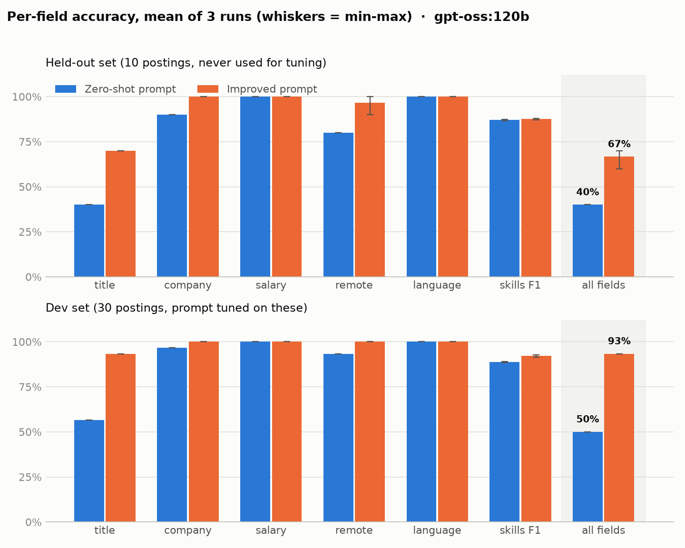
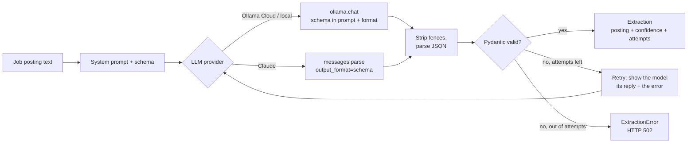

# LLM Structured Extractor

Turns messy job postings (English or German) into clean, validated JSON: **title, company, skills, salary, remote policy and language**. A Pydantic schema validates every answer, the extractor retries with the validation error when the model gets it wrong, and accuracy is measured field by field against hand-labelled postings, including a held-out set the prompt was never tuned on.

[](https://github.com/abhisheklakhani-it/llm-structured-extractor/actions/workflows/ci.yml)


```text
POST /extract
"Hallo zusammen, für einen unserer Kunden, ein Start-up aus dem Bereich Agrartechnik in Freising,
 suchen wir eine:n Machine Learning Engineer (m/w/d) ... Gehalt bis 78.000 € im Jahr,
 Remote-Arbeit bis zu 3 Tage pro Woche. Viele Grüße, Tobias, Hofmann IT-Personal"
```

```json
{
  "posting": {
    "title": "Machine Learning Engineer",
    "company": null,
    "skills": ["Python", "PyTorch", "OpenCV", "Azure", "Azure ML", "Docker"],
    "salary": {"min": null, "max": 78000, "currency": "EUR", "period": "year"},
    "remote": "hybrid",
    "language": "de"
  },
  "confidence": 0.95,
  "attempts": 1,
  "errors": []
}
```

The company is `null` because a recruiter is writing for an unnamed client (the agency is not the employer), and "bis 78.000 €" becomes an open-ended salary with only a maximum. This posting is from the held-out set.

## Results

Measured on 11 Oct 2026 with `gpt-oss:120b` on Ollama Cloud, temperature 0, **mean of 3 runs** (range in brackets). Each configuration was run three times because results still varied slightly between runs at temperature 0. Raw predictions and metrics: [`results/`](results/).



**Held-out set** (10 postings the prompt was never tuned on: this is the honest number)

| Field | Zero-shot prompt | Improved prompt |
|---|---|---|
| title | 0.40 | **0.70** |
| company | 0.90 | **1.00** |
| salary | 1.00 | 1.00 |
| remote | 0.80 | **0.97** (0.90–1.00) |
| language | 1.00 | 1.00 |
| skills precision / recall | 0.94 / 0.81 | 0.96 / 0.81 |
| skills F1 | 0.87 | 0.88 |
| **all scalar fields correct** | **0.40** | **0.67** (0.60–0.70) |

**Dev set** (30 postings; the improved prompt was written from the zero-shot errors on these, so its score here is optimistic)

| Field | Zero-shot prompt | Improved prompt |
|---|---|---|
| title | 0.57 | **0.93** |
| company | 0.97 | **1.00** |
| salary | 1.00 | 1.00 |
| remote | 0.93 | **1.00** |
| language | 1.00 | 1.00 |
| skills precision / recall | 0.96 / 0.83 | 0.96 / 0.89 |
| skills F1 | 0.89 | 0.92 |
| **all scalar fields correct** | **0.50** | **0.93** |

Median latency was about 5 s per posting. No extraction needed a retry in these 240 runs; the retry path is covered by tests with a fake model.

"All scalar fields correct" means title, company, salary, remote and language are all exactly right for a posting. Titles and companies are compared after lower-casing and unifying dashes and spaces; salary must match in all four parts. Skills are scored as a set, with micro precision and recall over all postings and a small alias table for true synonyms (`sklearn` = `scikit-learn`, `ASR` = `speech recognition`).

## What I learned

- **Ollama Cloud ignored the JSON schema.** Passing the schema as Ollama's `format` should constrain the output, but on Ollama Cloud `gpt-oss:120b` and `gemma4:31b` both answered with their own invented fields (`job_title`, `tech_stack`, `contact`) wrapped in a ```` ```json ```` fence. Writing the schema into the system prompt fixed it. Claude's `messages.parse` constrains decoding on the server, so it does not have this problem. Either way the reply goes through Pydantic, because a schema cannot express rules like "salary min ≤ max".
- **The zero-shot errors were about conventions, not understanding.** Salary and language were already perfect: the model read German notation like `4.200 – 4.800 € brutto monatlich` correctly every time. Almost all title errors were gender tags (`(m/w/d)`, `(f/m/x)`), and the remote errors were "office or fully remote, your choice". Writing the labelling rules into the prompt fixed most of them.
- **The held-out set keeps the score honest.** On the 30 postings used to write the prompt, all-fields-correct rose from 50% to 93%. On 10 postings the prompt never saw, it rose from 40% to 67%. The rules generalise, but the held-out gain (27 points) is only about two thirds of the dev-set gain (43 points): the rest was fitting those specific postings. Most remaining held-out title misses are judgement calls about whether a specialisation belongs in the title (`Senior Backend Engineer – Payments Team`, `Junior Data Scientist im Marketing`).
- **The model's confidence is not useful.** Across all 240 extractions, the self-reported confidence averaged 0.97 when every field was right and 0.98 when some field was wrong, never going below 0.95. Don't use it to decide which results to check by hand.
- **Skills recall is the ceiling.** Skills precision is high (0.96), but recall stayed at 0.81 on the held-out set. The model reliably lists tools, but often misses methods that are only described in the duties, such as "fraud detection" or "guardrails".

## How it works



| File | What it does |
|---|---|
| `src/jobextract/schema.py` | Pydantic models: `JobPosting`, `Salary` (ISO currency, min ≤ max), `LLMExtraction` (adds confidence), `Extraction` (the API answer) |
| `src/jobextract/llm.py` | Provider clients: Ollama (native API) and Claude (`messages.parse`), chosen by `LLM_PROVIDER` |
| `src/jobextract/prompts.py` | The zero-shot and improved system prompts, and the retry message |
| `src/jobextract/extractor.py` | Calls the model, cleans and validates the reply, retries with the error (max 3 attempts) |
| `src/jobextract/evaluation.py` | Field-level scoring: accuracy, skills precision/recall/F1, error listing |
| `src/jobextract/api.py` | FastAPI app: `GET /health`, `POST /extract` |
| `scripts/eval.py` | Runs the extractor on a split and saves predictions and metrics |
| `scripts/report.py` | Aggregates the repeated runs into `results/summary.json` and the chart |
| `data/` | 30 dev postings, 10 held-out postings, gold labels and the [labelling guide](data/LABELING.md) |

## Running it

```bash
python -m venv .venv && source .venv/bin/activate
pip install -r requirements-dev.txt
cp .env.example .env        # add a free Ollama Cloud key, or switch to Claude
```

| Variable | Default | Meaning |
|---|---|---|
| `LLM_PROVIDER` | `ollama` | `ollama` (Ollama Cloud or a local server) or `anthropic` (Claude) |
| `OLLAMA_API_KEY` | – | Key from ollama.com/settings/keys; not needed for a local server |
| `OLLAMA_HOST` | `https://ollama.com` | Set to `http://localhost:11434` for a local Ollama |
| `ANTHROPIC_API_KEY` | – | Key for Claude when `LLM_PROVIDER=anthropic` |
| `EXTRACT_MODEL` | `gpt-oss:120b` / `claude-opus-5-5` | Model for the chosen provider |

**API**

```bash
uvicorn jobextract.api:app --app-dir src --env-file .env
curl -X POST localhost:8000/extract -H 'Content-Type: application/json' \
     -d '{"text": "Senior Data Engineer (m/w/d) bei Acme GmbH ...", "prompt": "improved"}'
```

| Method | Path | Body | Returns |
|---|---|---|---|
| GET | `/health` | – | status, provider, model |
| POST | `/extract` | `{"text": "...", "prompt": "improved" \| "zero_shot"}` | `Extraction` JSON; 422 if the text is under 20 characters, 502 if the model never returns valid JSON, 503 if credentials are missing |

Interactive docs are at `/docs`.

**Evaluation**

```bash
python scripts/eval.py --prompt zero_shot                  # dev set
python scripts/eval.py --prompt improved --split heldout   # held-out set
python scripts/eval.py --prompt improved --rescore         # re-score saved predictions, no LLM calls
python scripts/report.py                                   # table + chart from all saved runs
```

**Tests** (43, no API key or network needed; the model is replaced with a fake)

```bash
pytest
```

## Limitations

- **Small, synthetic dataset.** The 40 postings are fictional (invented companies, no real people) but copy real formats. 10 held-out postings is enough to show the direction of a change, not to separate 67% from 70%: one posting is 10 points.
- **One labeller.** All labels follow [the labelling guide](data/LABELING.md) and were re-checked once against it, which fixed six dev-set skill lists ([the changes](data/LABELING.md#label-review-11-oct-2026)); the held-out labels needed none. Fields like the title and the skills list involve judgement, and a second labeller would disagree on some.
- **Only `gpt-oss:120b` was measured.** The Claude path (`messages.parse`) is implemented and its configuration is tested, but it was not benchmarked here because that needs a paid API key.
- **Confidence is self-reported** and, as measured above, not informative.

## Next steps

- [ ] Benchmark Claude with `messages.parse` on the same splits
- [ ] Grow the held-out set and add a second labeller to measure agreement
- [ ] Replace self-reported confidence with a measured signal (for example, agreement between two runs)
- [ ] Add invoices as a second document type
